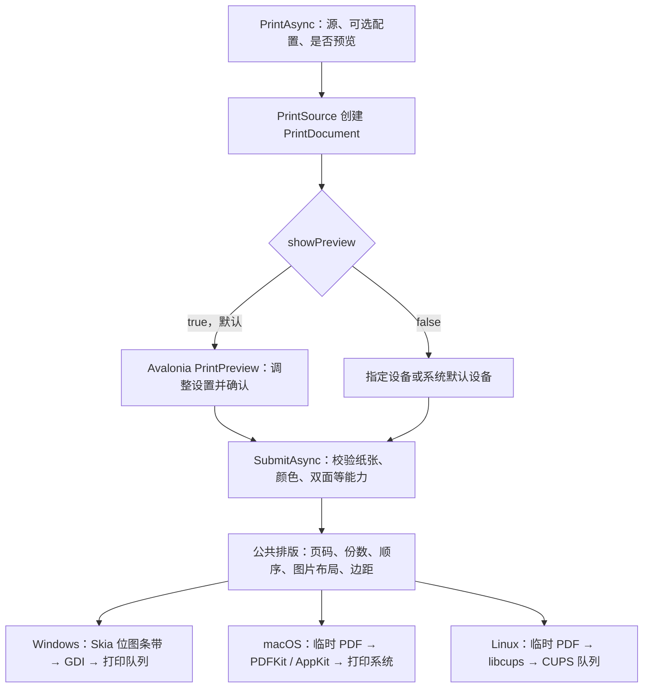

# 本项目跨平台打印原理

本项目采用**统一打印源、统一文档模型和排版，再通过各平台原生接口提交任务**的结构。Avalonia 提供界面与 Visual 捕获，SkiaSharp 负责页面绘制，系统打印服务负责驱动、队列与设备输出。

## 调用链



日常入口只有一个：

```csharp
await Printing.PrintAsync(source, options: null, showPreview: true);
```

`Printing` 是静态门面，内部使用 `PrintService`。服务通过 `OperatingSystem.IsWindows / IsMacOS / IsLinux` 延迟创建相应后端；业务代码使用同一 API。服务注册可选，MVVM 可以注入 `IPrintService`。

默认先打开本项目的 Avalonia 预览窗口，等待用户确认。`showPreview: false` 直接提交到指定 `PrinterId`，未指定时查找系统默认设备；无默认设备会报错。预览界面属于公共层，原生后端负责最终提交。

## 1. 把不同来源变为可绘制的文档

`PrintSource.CreateDocumentAsync()` 创建 `PrintDocument`，让后续流程只需知道文档纸张、页数和如何绘制指定页。

| 来源 | 当前处理方式 |
| --- | --- |
| 单个 PDF | PDFium 读取页数与尺寸，保留输入字节，在请求绘制某页时才渲染该页 |
| 单张／多张图片 | 保留图片编码数据，按选定布局计算页面与单元格，再解码、校正 EXIF 方向并绘制 |
| HTTP(S) PDF／图片 URL | 异步下载并检查响应类型、文件签名和大小，再复用 PDF／图片导入；按输入顺序组合网络图片 |
| Visual 视觉树 | UI 线程用 Avalonia `RenderTargetBitmap` 捕获已布局区域，形成固定页面快照 |
| 显式分页绘制 | 调用绘制回调，以 Skia `SKPicture` 记录每页内容 |
| 已有文档／混合业务来源 | 按来源与页码顺序创建统一纸张的文档快照；纯图片组合保留图片排版能力 |

PDF 只能单选，不能与其他来源混选；图片可以多选。Visual 捕获已布局的可见内容，长列表的虚拟化数据或离屏内容需要业务显式分页。

URL 下载发生在创建文档时，预览和直接打印共用这一步；不会把 URL 直接交给系统驱动。默认复用 HttpClient，支持重定向及压缩响应，超时覆盖响应头和响应体；调用方可传入自己的 HttpClient 配置认证和超时。PDF 上限 64 MB、单张图片 32 MB，图片集合总计 256 MB、最多 100 项。即使 URL 没有扩展名，识别出的 PDF 也必须独占来源。失败或取消时释放响应和中间文档，不提交部分任务。

PDFium 负责 **PDF 输入解析**，SkiaSharp 负责 **页面绘制与 PDF 输出**。当前 PDF 输入按需栅格化为 300 DPI，大页面限制为 1600 万像素及单边 8192 像素。混合尺寸 PDF 页面适配到首张纸张；导入后重新导出的 PDF 不保留原始矢量、可搜索文本或交互表单。

## 2. 公共层决定每一页的实际内容

`PrintLayout` 定义三端共同的打印规则：

- 内部坐标使用 point，72 point = 1 英寸；纸张、用户边距、图片间距使用 mm，通过 `72 / 25.4` 换算。
- 每一侧有效边距取用户边距与打印机硬边距的较大值，避免内容进入硬件无法输出的区域。
- 纸张方向、缩放、居中、裁切、黑白转换在绘制阶段执行。
- 图片先按每页一张、上下／左右两张、四宫格或九宫格组成页面，再应用页码范围、份数和双面规则。
- `OutputPages()` 统一展开份数与逐份／非逐份顺序；双面模式需要时插入空白面，防止前一份末页与后一份首页共用一张纸。

例如，6 张图片使用四宫格会组成 2 页，打印 2 份时输出页序列为 `1、2、1、2`。公共层已展开份数，因此平台驱动的份数设为 1，防止重复计算。

`PrintPreview`、缩略图、PDF 导出和系统打印最终共用 `PrintLayout.DrawSheet()`。屏幕预览把页面绘制成有尺寸上限的 PNG；打印使用实际纸张尺寸。放大屏幕预览不会改变纸张上的物理尺寸。

一致的排版规则可以减少预览与输出差异，但最终效果仍受驱动、实际纸张、设备边距和分辨率影响。

## 3. Windows：Skia 页面绘制后交给 GDI

后端为 `WindowsPrintBackend`，通过 .NET 原生调用访问 Windows 打印接口：

1. 查询打印机、默认设备、纸张、彩色和双面能力。
2. 使用 `DEVMODE` 配置纸张、方向、颜色与双面，并让驱动确认设置。
3. `CreateDCW("WINSPOOL", ...)` 创建打印设备上下文，读取分辨率、物理纸张和可打印区域。
4. `StartDocW` 建立任务，`StartPage` 开始每页。
5. Skia 按 `RasterDpi` 将页面绘制成位图条带，`StretchDIBits` 把各条带送入打印设备上下文。输出位图按条带分配，以控制高分辨率页面的位图内存。
6. `EndPage` / `EndDoc` 完成页面和任务，返回 Windows 队列任务 ID。

这一条路径直接从统一文档绘制到 GDI。Windows 的打印后台处理程序和设备驱动继续把任务转换为打印机可执行的数据。

## 4. macOS：临时 PDF 交给 PDFKit 与 AppKit

后端为 `MacPrintBackend`。它继承 CUPS 后端，复用设备发现和能力查询；提交任务使用随包部署的 Objective-C 原生桥接 `libTheOnePrinting.dylib`。

1. 通过 Avalonia UI 线程调用桥接，使用 PrintCore 将队列 ID 对应到实际打印设备。
2. 用 `NSPrintInfo.imageablePageBounds` 查询所选纸张和方向的硬件可打印区域。
3. `PrintRendering.WithTemporaryPdfAsync()` 把选定页面、排版、缩放及份数绘制为临时 PDF。
4. 桥接用 PDFKit 的 `PDFDocument` 打开这个 PDF，创建 `NSPrintOperation`。
5. 配置打印设备、纸张、方向、颜色和双面，关闭系统打印面板与进度面板后执行提交。
6. 返回提交结果并清理临时文件。

份数已经写入临时 PDF 的页面序列，原生层使用 1 份、100% 比例，并关闭 PDFKit 自动旋转，避免改变公共层的排版。当前返回结果不包含 macOS 队列任务 ID。

桥接原生调用要求主线程，因此由 `Dispatcher.UIThread` 调度。原生库已随 NuGet 提供，消费者不需要编译 Objective-C；当前桥接目标为 macOS 14 或更高版本。

## 5. Linux：临时 PDF 提交给 CUPS

后端为 `CupsPrintBackend`，直接调用系统 `libcups.so.2`：

1. `cupsGetDests2` 枚举队列和默认设备。
2. 查询媒体尺寸、硬边距、颜色和单双面能力。
3. 使用相同绘制链路生成临时 PDF。
4. 设置 `media`、`sides`、`print-color-mode`、`orientation-requested` 等 CUPS 选项。份数固定为 1，关闭额外的自动缩放和适合页面。
5. `cupsPrintFile2` 将 PDF 交给 CUPS，成功后返回队列任务 ID，并清理临时文件。

CUPS 服务及其过滤器、驱动继续处理设备协议。运行环境需要可用的 CUPS 客户端库、打印服务和已配置队列。

## 6. 为什么这些部分可以跨平台

| 层次 | 责任 | 主要实现 |
| --- | --- | --- |
| 应用 API | 来源、配置、预览开关、所属窗口与生命周期 | `PrintService.cs` |
| 输入文档 | 本地／网络 PDF 和图片、Visual、业务分页统一为文档 | `PrintSource.cs`、`RemotePrintSource.cs`、`PrintDocument.cs`、`PdfPrintDocument.cs`、`ImagePrintDocument.cs` |
| 排版与绘制 | 物理坐标、图片布局、边距、页序列、Skia 绘制 | `PrintLayout.cs`、`PrintRendering.cs` |
| 公共界面 | 设备与参数选择、缩略图、页面预览 | `PrintPreview*.cs` |
| 平台后端 | 系统设备能力、原生参数和任务提交 | `Platforms/*PrintBackend.cs` |
| 原生部署 | PDFium RID 资产、macOS 桥接与 CUPS 库解析 | NuGet 依赖、`NativeLibraries.cs`、`runtimes/`、`buildTransitive/` |

原生调用使用 `[LibraryImport]` 生成绑定，PDFium 按 RID 加载对应 DLL / dylib / so。macOS 桥接随包提供，CUPS 使用系统库；只有当前平台的后端会被实例化。

临时文档由服务管理并在操作结束后释放；调用方传入的流、Visual 和已有文档仍由调用方持有。临时打印 PDF 在私有任务目录中创建，提交完成或失败后尝试清理。

## 结果与验证边界

`PrintResult` 表示取消或系统提交结果。任务进入队列之后，缺纸、离线或设备故障仍可能影响出纸；本项目当前没有等待真实打印完成的设备状态闭环。提交开始后的取消为尽力操作，结果不明确时不应自动重试。

截至 2026-10-16，`1.0.0-preview.3` 已发布且可从 nuget.org 还原。macOS arm64 的 PreviewHost 已使用全新缓存从官方源还原并构建，0 警告、0 错误；实际消费 DLL 与线上包一致。公网 HTTPS PDF 正文和缩略图正常显示；5 张公网 PNG/JPEG/WebP 图片默认 5 页，切换四宫格后为 2 页，内容及顺序正确。

线上包验证使用托管宿主；此前本地 NuGet 包已完成 macOS arm64 NativeAOT 文档与排版实跑，线上包未重复运行 NativeAOT。两次验证均未发送真实打印任务。历史测试与构建缓存已清理，复验时需重新还原和构建；步骤见 [开发说明](DEVELOPMENT.md)。

Windows / Linux 原生运行、真实出纸和沙箱部署尚未验证。macOS 临时宿主的原生文件选择器曾出现 Open 按钮禁用，本地文件选择到预览的流程仍需复核；网络 URL 预览通过没有解决该原生选择器问题。

本说明依据当前仓库实现及已完成的验证结果整理；本次文档更新未重新执行打印专项。调用方法见 [使用指南](USAGE.zh-cn.md)。
